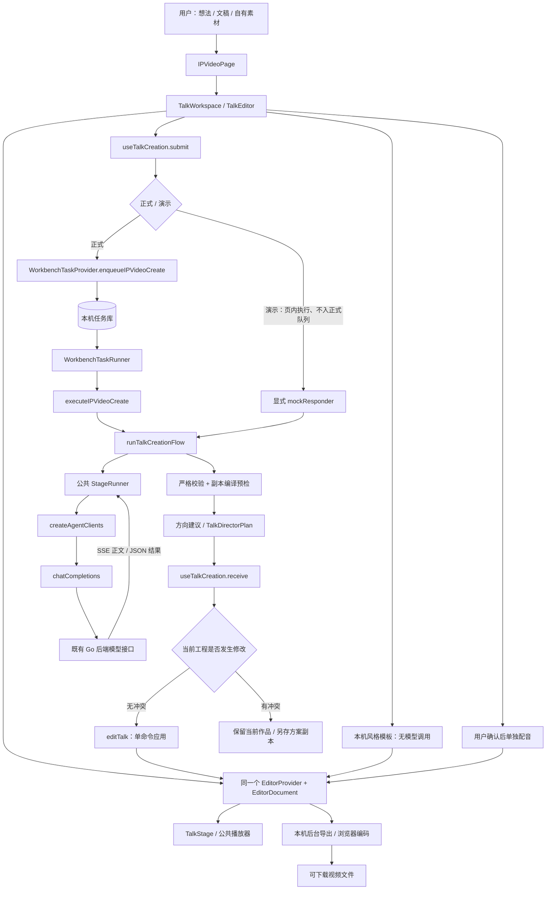
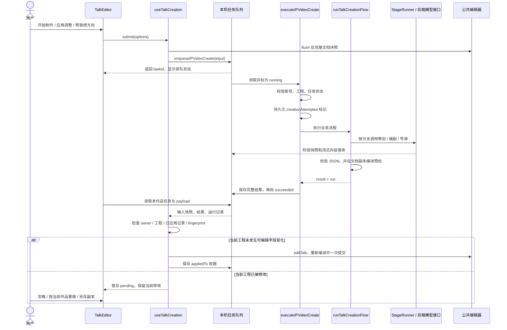
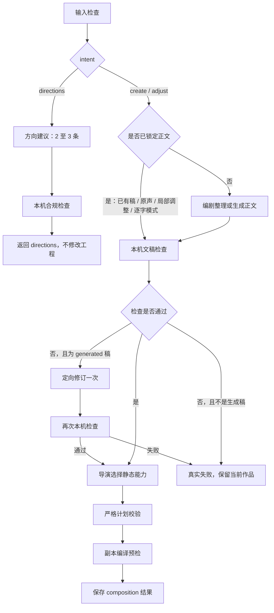
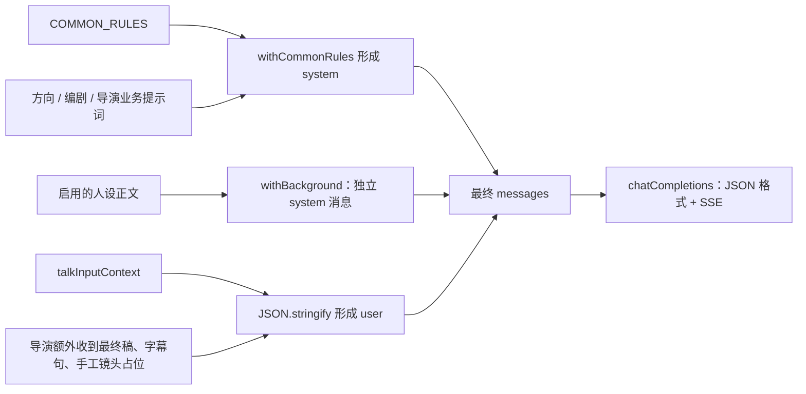
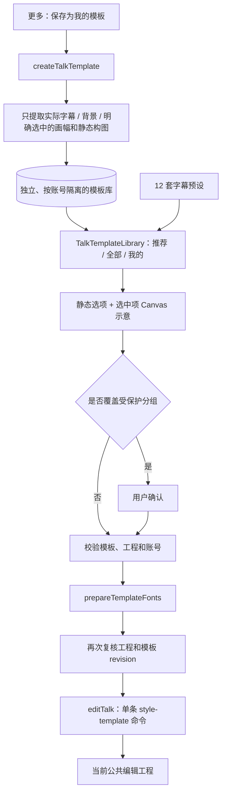

# IP 口播视频：架构调用图、设计思路与提示词维护指南

> 源码核对日期：2026-10-23。本文描述独立网页项目当前的 IP 口播 V2 实现。
>
> **阅读定位**：用于后续调整交互、生成策略、提示词、模板、配音和导出。源码及 [API 契约](../API_CONTRACTS.md) 是实现权威；本文是维护导航，不把接线完成等同于运行验收通过。
>
> 本次整理只阅读源码和更新文档，未运行测试、类型检查、构建、浏览器或真实模型调用。

## 目录

1. [一句话理解系统](#1-一句话理解系统)
2. [总体架构调用图](#2-总体架构调用图)
3. [页面组件与状态归属](#3-页面组件与状态归属)
4. [AI 创作完整调用链](#4-ai-创作完整调用链)
5. [实际执行的阶段与分支](#5-实际执行的阶段与分支)
6. [提示词文件、拼接方式与调整入口](#6-提示词文件拼接方式与调整入口)
7. [结构化计划与确定性编译](#7-结构化计划与确定性编译)
8. [风格模板的独立调用链](#8-风格模板的独立调用链)
9. [素材、配音与原声](#9-素材配音与原声)
10. [预览和导出](#10-预览和导出)
11. [数据存储与账号隔离](#11-数据存储与账号隔离)
12. [设计思路与取舍](#12-设计思路与取舍)
13. [后续需求应该改哪里](#13-后续需求应该改哪里)
14. [维护时必须保留的约束](#14-维护时必须保留的约束)
15. [验证入口与当前边界](#15-验证入口与当前边界)

## 1. 一句话理解系统

**浏览器负责创作编排与视频编辑；后端负责模型请求和配音接口；AI 只返回受限 JSON 计划，本机代码将计划编译进同一个编辑工程，最终在浏览器合成视频。**

几个概念先区分：

- **作品 / 工程**：公共视频编辑器的 `EditorDocument`，承载画布、轨道、素材引用、字幕、镜头与口播元数据。
- **创作任务**：本机后台任务 `ip_video_create`，产物是方向建议或导演计划，产物不是 MP4。
- **配音任务**：`ip_video_audio`，单独确认后请求语音合成，产物是音频。
- **导出任务**：复用 `video_factory_export` 任务类型，用 `source: 'ip-composition'` 区分口播作品；此处复用执行能力，不共用作品库。
- **风格模板**：本机保存的实际字幕与背景参数，可选画幅和静态主视觉构图；不包含整篇稿件、声音、媒体或完整镜头时序。
- **内容镜头**：开发阶段已实现、静态登记的文字动效组件。AI 选择组件和文案，不生成组件代码。

当前没有服务端视频渲染任务、云端作品同步、语音自动转写、自动人物抠像或任意动态代码执行链。

## 2. 总体架构调用图

下面图中的“本机后台”仍在当前浏览器内运行，不是关闭浏览器也能继续工作的云端队列。

主要源码：

- 页面入口：[IPVideoPage.tsx](../src/features/ip-video/IPVideoPage.tsx)。
- 工作区：[TalkWorkspace.tsx](../src/features/ip-video/composition/TalkWorkspace.tsx)。
- 生成协调：[use-talk-creation.ts](../src/features/ip-video/composition/use-talk-creation.ts)。
- 业务流程：[video-assembly-flow.ts](../src/features/ip-video/agent/video-assembly-flow.ts)。
- 任务执行器：[ip-video-create.ts](../src/services/workbench-tasks/executors/ip-video-create.ts)。

## 3. 页面组件与状态归属

### 3.1 页头、工作区与公共编辑器

`IPVideoPage` 负责创作 / 历史切换、当前登录账号、路由中的 `taskId` / `digitalHumanProject`，并提供页头挂载点。

`TalkWorkspace` 调用 `useTalkProject(owner)`，取得当前账号的工程和素材仓储；工程准备好后创建 `EditorProvider`，其中的 `TalkEditor` 消费同一个编辑器实例。

`TalkProjectToolbar` 使用 React Portal 把作品切换、保存状态、撤销、重做、更多和导出渲染到页头。Portal 只改变 DOM 位置，仍使用编辑器原有上下文和撤销栈；没有把整套工程状态提升到页面外。

### 3.2 各文件的职责

- [use-talk-project.ts](../src/features/ip-video/composition/use-talk-project.ts)：打开、新建、删除、保存作品；创建 / 释放编辑器；文档变化后延迟 600ms 自动保存，显式 `flush()` 用于重要操作前保存。
- [talk-pipeline.ts](../src/features/ip-video/composition/talk-pipeline.ts)：唯一的六步流水线定义、阶段序号和进入条件。
- [TalkWorkspace.tsx](../src/features/ip-video/composition/TalkWorkspace.tsx)：串起六个步骤；只有一条主路径，不再维护第二套引导或右侧入口面板。
- [pipeline/TalkContentStep.tsx](../src/features/ip-video/composition/pipeline/TalkContentStep.tsx)：第 1 步内容输入与方向建议。
- [pipeline/TalkVisualStep.tsx](../src/features/ip-video/composition/pipeline/TalkVisualStep.tsx)：第 2 步画幅、成片样式与 AI 图片入口。
- [pipeline/TalkVoiceStep.tsx](../src/features/ip-video/composition/pipeline/TalkVoiceStep.tsx)：第 3 步音色、语速、导入声音。
- [pipeline/TalkGenerateStep.tsx](../src/features/ip-video/composition/pipeline/TalkGenerateStep.tsx)：第 4 步生成 / 局部调整的确认页。
- [pipeline/TalkEditStep.tsx](../src/features/ip-video/composition/pipeline/TalkEditStep.tsx)：第 5 步对象栏 + 画布 + 属性检查器，左右列可拖拽调宽。
- [pipeline/TalkExportStep.tsx](../src/features/ip-video/composition/pipeline/TalkExportStep.tsx)：第 6 步 1:1 封面与合成前检查。
- [pipeline/TalkAdvancedSettingsDialog.tsx](../src/features/ip-video/composition/pipeline/TalkAdvancedSettingsDialog.tsx)：唯一的「高级设置」二级弹窗；不重复承接画幅或配音。
- [TalkStage.tsx](../src/features/ip-video/composition/TalkStage.tsx)：视频预览、媒体缓存、试听音频、字体就绪与舞台点击 / 拖动入口。
- [TalkCaptionPanel.tsx](../src/features/ip-video/composition/TalkCaptionPanel.tsx)、[TalkMediaPanel.tsx](../src/features/ip-video/composition/TalkMediaPanel.tsx) 与 [TalkShotPanel.tsx](../src/features/ip-video/composition/TalkShotPanel.tsx)：第 5 步的三种属性检查器内容。
- [talk-model.ts](../src/features/ip-video/composition/talk-model.ts)：口播领域纯函数，以及公共命令封装 `editTalk`。

### 3.3 哪些是界面状态，哪些进工程

- 当前步骤 `stage`、是否已有结果 `resultMode`、高级设置弹窗、属性检查器页签、时间轴开关、素材橱窗等：由 `TalkEditor` 的 React 状态控制。
- 正文、音色、语速、音频版本、字幕样式、字幕时序、素材、轨道、导演计划、保护分组、已应用任务记录：在 `EditorDocument` / `ipVideo` 中。
- `brief` 草稿通过 `rememberBrief` 写入 `ipVideo.creation.brief`；本次局部调整输入 `adjustment` 是当前编辑器内的界面状态，不代表独立长期保存的草稿库。
- `resultMode` 只区分“尚未生成”和“已有可编辑结果”，不另建预览工程。直接导入素材后也会进入同一编辑路径。
- [talk-creation-availability.ts](../src/features/ip-video/composition/talk-creation-availability.ts) 统一直接表单和提交入口的制作条件：首次制作可有想法、文稿或原声；已有作品的局部调整必须有明确调整文字。方向建议另用 `canSuggestTalkDirection`：必须有用户自己写的想法或口播文稿，默认开启的人设不算。

六个步骤共用同一工程、同一时间轴和同一撤销栈，不是六个编辑器。

## 4. AI 创作完整调用链

### 4.1 正式模式时序

### 4.2 各层负责什么

1. `TalkEditor.make()` 合并 UI 选项与 `ipVideo.aiProtected`，决定 `intent`，传入当前启用的人设背景。
2. `useTalkCreation.submit()` 先保存当前作品，再 `structuredClone` 工程；正式模式只入队，不在页面里阻塞等全部模型完成。
3. [WorkbenchTaskProvider.tsx](../src/services/workbench-tasks/WorkbenchTaskProvider.tsx) 的 `enqueueIPVideoCreate()` 再校验登录态和工程账号，创建任务、通知 Runner。
4. [task-runner.ts](../src/services/workbench-tasks/task-runner.ts) 将 `ip_video_create` 分发给专用执行器。口播创作占用本机串行执行槽，不在其中再等待配音任务。
5. `executeIPVideoCreate()` 读取输入、记录启动标记，运行 flow 并保存结果。**它只生成方案，不修改作品工程。**
6. `useTalkCreation.receive()` 在页面观察到成功结果后处理。方向建议只展示选项；导演结果在账号 / 工程 / 冲突检查通过后自动应用。
7. `compileTalkDirectorPlan()` 在预检和实际应用时都会执行；预检可用，不代表可以越过实际应用前的版本检查。

### 4.3 防重复调用与冲突

- `creationAttempted: '1'` 在收费请求前持久化。任务已尝试但没有完整结果时，停止自动重跑，而不是刷新后悄悄再收费。
- 已保存 `payload.result` 时优先复用结果，不因最终任务状态写入中断而重新调用模型。
- `talkCreationFingerprint()` 比较画布、轨道、字幕、全局样式、素材、正文、语速、保护项、模板标识等可编辑字段；不把单纯加载默认音色视为作品内容修改。
- `ipVideo.creation.appliedTaskIds`、任务 `appliedTo` 收据和当前页面的 `seen` 集合共同处理重复结果。
- 工程冲突进入 `pending`，不会自动覆盖；另存副本使用原任务输入快照编译，不把旧计划强套到新工程。
- 页面离开后正式创作可由全局 Runner 继续；应用工程需要页面读取结果。演示流程是页内执行，卸载时取消。

## 5. 实际执行的阶段与分支

注册入口为 [features/agent-flows.ts](../src/features/agent-flows.ts)；流程 ID 仍为 `ip-video-assembly-v1`。页面叫 V2 不等于流程 ID 已改成 v2。

当前声明 7 个阶段，按条件执行，不是每次串行跑 7 次模型：

- `parse-manuscript`：本机算法。检查输入并确定是否锁定文稿。
- `talk-directions`：AI，`plan` 策略。仅方向建议分支。
- `talk-script`：AI，`draft` 策略。只有未取得锁定正文时才调用。
- `talk-hard-check`：本机 `runHardCheck`，不是 AI 打分。
- `talk-repair`：AI，`draft` 策略。仅生成稿检查失败时定向修复一次。
- `select-components`：AI，`plan` 策略。输出导演计划。
- `compile-assembly-plan`：本机检查画面文案，并在工程副本上编译。

### 5.1 文稿锁定的实际优先级

权威函数是 [schema.ts](../src/features/ip-video/agent/schema.ts) 的 `resolveLockedTalkScript()`：

1. `intent === 'adjust'` 或已有可用原声：锁定工程现有 `ipVideo.script`。原声无稿时可以锁定为空字符串，只安排视觉。
2. `scriptMode === 'verbatim'`：把本次 `brief` 当逐字原稿，经过纯文本检查后直接使用。
3. `scriptMode === 'rewrite'`：允许进入编剧步骤。
4. `auto` 且工程已经有稿：使用工程原稿。
5. 其他情况由编剧判断本次输入是完整稿还是想法；不能用输入长度替代判断。

因此，仅修改编剧提示词，无法让“局部调整”偷偷改稿，也无法改写已有原声的正文绑定。要改变这类产品行为，必须先调整锁稿规则与确认交互。

### 5.2 调用次数、重试和模型策略

- 方向建议分支：1 次模型请求。
- 已锁稿的制作 / 调整：通常 1 次导演请求。
- 需要写稿：通常为编剧 + 导演，2 次。
- 生成稿需修复：编剧 + 修复 + 导演，最多 3 次；不是一个开放式循环。
- 当前这些 `runModel` 调用显式传 `retry: 0`，覆盖公共预算的默认重试次数。
- [models.ts](../src/agent/models.ts) 中 `plan` 为温度 0.2 / 4096 tokens，`draft` 为温度 0.8 / 8192 tokens。这里是调用参数策略，不是具体厂商模型。
- [budgets.ts](../src/agent/budgets.ts) 中远端默认单步 150 秒；`StageRunner.runModel` 的流式空闲超时为 `min(120 秒, 单步预算)`，同时有单步总时限。预算对象中的 `flowMs` 不能直接当作本 flow 已接入的总超时保证，口播 flow 没有在外层使用该值包裹整个流程。
- 浏览器不发送模型标识；具体模型选择由既有后端能力链裁决。修改网页 `plan` / `draft` 不等于切换后端模型。

## 6. 提示词文件、拼接方式与调整入口

### 6.1 真正需要优先看的文件

**业务提示词唯一集中入口：[src/features/ip-video/agent/prompts.ts](../src/features/ip-video/agent/prompts.ts)。**

包含四个关键出口：

- `TALK_DIRECTIONS_SYSTEM`：策划角色，要求返回 2–3 条 `title / opening / reason`，不生成整稿。
- `TALK_SCRIPT_SYSTEM`：编剧角色，要求返回 `source / script`，区分原文识别与生成稿；同一份提示词也用于 `talk-repair`。
- `talkDirectorSystem()`：导演提示词工厂，约束输出 `TalkDirectorPlan`，并动态拼入字幕预设和内容镜头白名单。
- `talkInputContext(input)`：生成发送给模型的结构化上下文。它不是 system 文案，但决定模型实际知道哪些信息。

其他直接关联文件：

- [src/agent/prompt.ts](../src/agent/prompt.ts)：`COMMON_RULES`、`withCommonRules()`，影响多个生成页面，不仅是口播。
- [src/features/ip-video/agent/video-assembly-flow.ts](../src/features/ip-video/agent/video-assembly-flow.ts)：决定每阶段使用哪个 system、发送什么 user JSON、何时修复、如何解析。
- [src/features/ip-video/agent/schema.ts](../src/features/ip-video/agent/schema.ts)：输出字段白名单、纯文本检查、静态枚举、锁稿和时长策略。
- [src/features/ip-video/agent/types.ts](../src/features/ip-video/agent/types.ts)：输入、方向结果、导演计划、运行结果的 TypeScript 契约。
- [src/features/ip-video/agent/mock-responder.ts](../src/features/ip-video/agent/mock-responder.ts)：演示应答，不是正式提示词，也不会在正式失败后兜底。
- [src/agent/clients.ts](../src/agent/clients.ts)：人设背景插入、正式 / 演示选择、统一模型传输适配。
- [src/agent/stage-runner.ts](../src/agent/stage-runner.ts)：阶段执行、实际提示词快照、流式记录、超时和请求参数。

### 6.2 最终请求是怎样组成的

消息顺序为：

1. 任务 system：公共规则在前，业务规则在后。
2. 有人设时增加独立 system：`【背景上下文】` 加人设正文。
3. user：结构化输入 JSON。

口播当前直接 `JSON.stringify(context)` 传入 user，不使用一套独立的 Markdown 提示词模板文件，也没有在本 flow 中使用 `renderTemplate()` 的变量占位方式。

### 6.3 各阶段实际输入和输出

**方向建议 `talk-directions`**

- system：`withCommonRules(TALK_DIRECTIONS_SYSTEM)`。
- user：`talkInputContext(input)` 的 JSON。
- 输出：只有 `directions`；每条严格为 `title / opening / reason`。
- 校验：2–3 条；标题不重复；纯文本及长度限制；随后做统一合规检查。
- 调整重点：方向差异、开场方式、理由表达。不要同时把它扩成整稿生成。

**文稿 `talk-script`**

- system：`withCommonRules(TALK_SCRIPT_SYSTEM)`。
- user：相同的基础上下文，含 `brief`、`existingScript`、`scriptMode`、`intent` 等。
- 输出：严格为 `source / script`。
- `source=verbatim` 只允许在 `auto` 且输出正文逐字等于 `brief` 时通过；长度和格式不足以证明它是完整稿。
- 调整重点：口语感、内容结构、原文判定和改写范围。

**定向修复 `talk-repair`**

- 复用 `TALK_SCRIPT_SYSTEM`，没有另一个 repair 提示词文件。
- user 在基础上下文上加入 `scriptMode: 'rewrite'`、当前 `script`、`mustFix: check.hits`。
- 输出仍为 `source / script`，且必须标记为 `generated`。
- 修复最多一次，之后再查；仍不合规则真实失败，不截断正文冒充合格。

**导演 `select-components`**

- system：`withCommonRules(talkDirectorSystem())`。
- user：基础上下文 + `script` 最终稿 + `cues` 字幕句列表 + `occupied` 手工镜头时间区间。
- 每句带 `cueIndex / text / startUs / durationUs`；这是本机已知或估算的字幕时间，不是语音识别。
- 输出必须逐字保留最终稿，选择静态预设、构图、画幅、动效级别与内容镜头。
- 调整重点：镜头密度、何时强调、不同语气的风格偏好、局部调整的保留原则。

### 6.4 模型具体看到了什么

基础上下文包含：

- `brief`、`intent`、`scriptMode`、`existingScript`、`adjustment`。
- `ratio`、`captionPresetId`、`motion`、`preserve`。
- 当前预设、画幅、由现有画框归类的构图、照片动效、字幕动效级别、声音与文稿是否匹配。
- 已有镜头的类型、时间、文案、是否 AI 生成和轨道锁定状态。

**当前 flow 没有上传照片 / 视频给视觉模型理解，也没有调用联网检索。** 公共客户端虽然具备搜索能力，但口播流程使用 `runModel`，没有使用 `runModelWithTools` 或 `runSearch`。不能把现有“按素材安排”描述为已经识别画面语义、人物口型或原声内容。

工程完整快照保存在本机任务输入里，不等于整份工程 JSON 原样发给模型。`talkInputContext()` 是二者之间的明确收敛入口。

### 6.5 提示词调整时的联动规则

- 只改表达语气 / 选材偏好：优先改 `prompts.ts`，再检查演示文案是否需要同步。
- 改模型收到的字段：改 `talkInputContext()` 和 flow 中的额外上下文；同时检查数据边界。
- 改返回字段或枚举：必须同时改 `types.ts`、`schema.ts`、flow 解析、compiler 和 mock，不能只改提示词。
- 改“镜头最多 12 个”：提示词和 `validateTalkDirectorPlan()` 都有约束，要同步。
- 改“短标题 18 字 / 副标题 36 字”：除提示词和 schema 外，还需同步公共内容镜头的 `CONTENT_SHOT_TEXT_LIMITS`、控件和布局。
- 改“至少 0.6 秒展示”：需要同步导演提示词、compiler 的空间检查及相关断言。
- 公共规则目前提到无法确定时使用 `null / assumptions`，但口播 schema 是严格白名单。**不能因此让口播结果额外返回 `assumptions`**；若要支持假设说明，应先统一输出契约，而不是放宽所有未登记字段。

### 6.6 排障时去哪看实际提示词

`StageRunner` 把 system 和 user 合成 `actualPrompt`，跟随 `AgentRunSnapshot` 保存到任务 payload 的 `run` 中，供本机源码级排障。

注意两个边界：

- `actualPrompt` 不包含通过 `withBackground()` 后插入的独立人设 system；重现最终请求时还需核对任务输入中的 `personaContent` 和客户端背景拼接逻辑。
- UI 过程面板只展示阶段状态与过滤后的正文，不展示或提供复制提示词入口；不要为排障把内部提示词重新暴露到用户界面。

流式正文的过滤入口是 [stream-filter.ts](../src/agent/stream-filter.ts) 的 `createDisplayDelta()`；页面读取阶段 `streamingContent` 时还通过 `displayTalkText()` 只抽取允许的正文键。

## 7. 结构化计划与确定性编译

### 7.1 AI 可选择的计划字段

`TalkDirectorPlan` 当前严格包括：

- `version`：当前为 1。
- `title`：作品标题。
- `script`：逐字复制给定最终稿；无转写的原声模式可为空。
- `summary`：安排摘要。
- `captionPresetId`：静态字幕预设 ID。
- `ratio`：`9:16 / 16:9 / 1:1`。
- `composition`：`full / side / top / pip`。
- `motion`：`calm / normal / lively`。
- `shots`：每项只有 `shotId / text / subline / cueIndex`。

模型不能返回工程 ID、素材地址、任意组件路径、代码、CSS、表达式、画面坐标或镜头绝对时间。具体坐标、素材引用和开始结束时间由可信本机代码决定。

### 7.2 编译器负责把“意图”变成工程

权威文件：[talk-director-compiler.ts](../src/features/ip-video/composition/talk-director-compiler.ts)。

`compileTalkDirectorPlan()` 的主要动作：

1. 再次校验计划、任务标识、工程 ID 和 revision。
2. 重新判定锁稿，阻止导演改写最终正文。
3. 检查受保护字幕 / 人工校时与新稿的差异。
4. 确定节目时长：已有音视频真实时长优先，否则估算正文时长；超过 5 分钟明确失败。
5. 按保护项决定是否调整画幅、人物构图、照片动效和字幕样式。
6. 将 `cueIndex` 映射为字幕时间，避让手工镜头，按下一锚点与镜头源帧长限定时长。
7. 仅替换 `ip-director-shot-` 前缀标记的 AI 镜头；手工镜头不因 AI 重排自动删除。
8. 保存导演计划与镜头时序引用，执行字幕、镜头边界、公共工程 schema 检查。
9. 返回新文档，由调用方 `editTalk()` 提交，而不是编译器自行改编辑器状态。

`retimeTalkDirectorShots()` 在新音频绑定后按实际字幕时间重新定位可自动管理的 AI 镜头；如果镜头已手工移动、裁剪、受保护或参考不匹配，保留并检查边界，不把它假装成仍可随意重排的 AI 产物。

### 7.3 当前开放的 6 个内容镜头

定义源：[content-variants.tsx](../packages/video-editor/src/demos/content-variants.tsx) 的 `CONTENT_SHOT_DEFINITIONS`。

- `typography/blur-slide`：柔焦滑入。
- `typography/flying-words`：文字纵深飞入。
- `typography/outline-word-fill`：描边点亮。
- `typography/gradient-word-sweep`：渐变扫光。
- `typography/marker-underline-title`：马克笔划线。
- `typography/title-demote-to-label`：标题收为标签。

[talk-shot-catalog.ts](../src/features/ip-video/composition/talk-shot-catalog.ts) 记录适配判断和可用边界；[talk-shot-commands.ts](../src/features/ip-video/composition/talk-shot-commands.ts) 负责插入及编辑约束。

新增镜头要先实现内容版、登记静态目录、校验和渲染，再让导演看到。把名字加进提示词不能让一个原始演示自动变成可用镜头。详细兼容说明见 [ip-talk-shot-compatibility.md](ip-talk-shot-compatibility.md)。

## 8. 风格模板的独立调用链

文件职责：

- [templates/model.ts](../src/features/ip-video/composition/templates/model.ts)：版本化模板类型、字段白名单、归一化构图提取、保护检查、纯函数应用。
- [templates/repository.ts](../src/features/ip-video/composition/templates/repository.ts)：独立 IndexedDB、账号索引、唯一名称、读写和版本冲突。
- [templates/TalkTemplateSaveDialog.tsx](../src/features/ip-video/composition/templates/TalkTemplateSaveDialog.tsx)：命名保存；画幅、人物构图分别选择。
- [templates/TalkTemplateLibrary.tsx](../src/features/ip-video/composition/templates/TalkTemplateLibrary.tsx)：预览、应用确认、重命名、删除和异步版本复核。
- [templates/fonts.ts](../src/features/ip-video/composition/templates/fonts.ts)：等待全局及逐句覆盖字体就绪。
- [TalkStyleLibrary.tsx](../src/features/ip-video/composition/TalkStyleLibrary.tsx)：复用 `StylePreview`，用公共 Canvas 渲染字幕示意。
- [talk-caption-presets.ts](../src/features/ip-video/composition/talk-caption-presets.ts)：12 套实际字幕参数。
- [editor/caption-fonts.ts](../src/features/ip-video/editor/caption-fonts.ts)：本地字体登记与按需加载。

维护重点：

- 保存实际 `CaptionStyle` 和背景，而非只保存预设 ID。
- 默认应用不改文稿、字幕时间、逐句覆盖、声音、照片时间、手工镜头或关键帧。
- 构图只接受明确的主视觉轨、统一静态画框；不同构图、重叠素材、额外视觉层、动画 / 有效蒙版及隐藏 / 锁定主轨会拒绝该可选操作。
- 画幅单独应用只改画布尺寸，不重建原素材变换或关键帧；可能需要用户手工调整画面，不能称为完整自适应套版。
- 应用后保护字幕和构图分组。下一轮 AI 制作通过有效 `preserve` 选项保留自定义效果，不要求模型复刻任意 CSS。
- 本链路不调用模型、不提交配音、不产生云端同步。

## 9. 素材、配音与原声

### 9.1 本机素材入口

[use-talk-inputs.ts](../src/features/ip-video/composition/use-talk-inputs.ts) 负责 `persistAsset / addFiles / importTask / generate / retryBinding`。

- 文件导入先通过 `MediabunnyMediaAdapter.probe()` 读取媒体信息，再保存 Blob 和工程引用。
- 图片、视频、音频、SRT 走各自校验；SRT 形成 `timingSource: 'srt'` 的字幕，不当成估时字幕随意覆盖。
- 导入本机文件用于本机编辑，不等于已上传给 AI 识别。
- 使用已有数字人成片由 `TalkWorkspace.importDigital()` 和 [digital-human-adapter.ts](../src/features/ip-video/adapters/digital-human-adapter.ts) 接入，导入现有版本不提交新的换口型任务。

### 9.2 配音单独确认

调用顺序：

1. `TalkEditor.requestAudio()` 打开文稿 / 音色确认弹窗。
2. `submitReviewedAudio()` 拍下正文、音色、语速；正式提交前再次检查三者未变。
3. `useTalkInputs.generate()` 检查非演示、正文和音色有效、人工字幕校时已明确处理。
4. `enqueueIPVideoAudio()` 提交独立任务。
5. 任务完成后 `importTask()` 优先读取本机音频 Blob；缺失时通过既有播放地址读取。
6. 把音频复制进当前作品素材库，以真实时长绑定；保留正文 / 原声版本关系，更新允许重新估时的字幕与 AI 镜头。

`retryBinding()` 是重新读取已完成音频，不是再次收费合成。文稿改了、声音没变时页面明确提示版本不一致。

### 9.3 配音执行器、接口与入队限制

`ip_video_audio` 没有单独的音频执行器文件，它与普通 `voice_tts` 共用以下链路：

`WorkbenchTaskRunner → executeVoiceTts → createSpeech → POST /api/v1/ai/audio/speech → 下载平台音频 → 本机任务 Blob → useTalkInputs.importTask → 口播工程素材副本`。

- 执行器：[executors/voice-tts.ts](../src/services/workbench-tasks/executors/voice-tts.ts)。
- 请求封装：[src/api/tts.ts](../src/api/tts.ts) 的 `createSpeech()`；请求字段为 `input / voice / rate`，默认 `response_format: 'wav'`，超时为 600000ms，不传模型标识。
- `templateId: 'scroll'` 只是口播任务载荷字段，不会被该执行器发送给 TTS 接口。
- 入队硬限制位于 [idb-repository.ts](../src/services/workbench-tasks/idb-repository.ts) 的 `createIPVideoAudioJob()`：去空白后至少 20 字，语速为 0.8–1.5，音色不能为空或演示音色。
- 页面语速滑块的 `min` 与仓储校验共用 [voice-speed.ts](../src/lib/voice-speed.ts) 的 0.8–1.5；旧的 0.7 下限已移除，页面不会再提交必然被拒绝的值。

### 9.4 原声与配音的优先原则

- 有可用原声时优先保留，不自动重新配音。
- 无文稿 / SRT 的原声可做视觉安排，但不生成猜测字幕，也不声称音画文字已同步。
- 人工校时字幕不能被新配音无确认覆盖；生成前需要用户明确处理重新估时。
- 改字体、模板、构图、镜头或切换简洁 / 高级视图，不触发配音。
- TTS 是 Text-to-Speech，即文本转语音；它的结果不是语音转写或逐字对齐数据。

接口权威见 [API_CONTRACTS.md 的 IP 口播章节](../API_CONTRACTS.md#ip-口播视频)，配音请求经项目 API 封装访问 `/api/v1/ai/audio/speech`，不由页面直连厂商。

## 10. 预览和导出

### 10.1 预览

`TalkStage` 使用公共 `PlayerSurface`，启用 `layeredShots`：

- [render/plan.ts](../packages/video-editor/src/render/plan.ts)：建立渲染计划。
- [render/evaluator.ts](../packages/video-editor/src/render/evaluator.ts)：按时刻求元素与动画状态。
- [render/compositor.ts](../packages/video-editor/src/render/compositor.ts)：Canvas 合成。
- [render/captions.ts](../packages/video-editor/src/render/captions.ts)：字幕布局、动效和字体。
- [panels/player/layered-player.tsx](../packages/video-editor/src/panels/player/layered-player.tsx)：组织 Canvas 层与实时镜头层。
- [panels/player/LiveShotLayer.tsx](../packages/video-editor/src/panels/player/LiveShotLayer.tsx)：实时内容镜头。
- [use-asset-media-cache.ts](../src/lib/video-editor/use-asset-media-cache.ts)：本机媒体读取和缓存。
- [use-preview-audio.ts](../src/features/video-factory/lib/use-preview-audio.ts)：同一工程的试听音频。

字幕示意和作品舞台复用公共渲染能力，但短句示意不能替代真实素材、多图层和音画同步验收。

### 10.2 导出主链

调用入口为 `TalkEditor.requestExport()`：先检查口播导出问题与字幕时序，无声或声音版本不一致时让用户明确确认，再调用公共导出入队 hook。

后续链路：

`useVideoExportEnqueue.onEnqueue → enqueueVideoFactoryExport → 本机任务 Runner → executeVideoFactoryExport → runBrowserExport → 公共导出控制器 / 媒体编码 → 成片 Blob 与下载入口`。

主要维护文件：

- [talk-export-checks.ts](../src/features/ip-video/composition/talk-export-checks.ts)：口播专属导出前置条件。
- [use-video-export-enqueue.ts](../src/features/video-factory/lib/use-video-export-enqueue.ts)：创建工程快照与导出任务。
- [executors/video-factory-export.ts](../src/services/workbench-tasks/executors/video-factory-export.ts)：后台导出执行。
- [run-browser-export.ts](../src/features/video-factory/lib/run-browser-export.ts)：浏览器导出装配。
- [core/export/controller.ts](../packages/video-editor/src/core/export/controller.ts)：公共导出生命周期。
- [core/export/preflight.ts](../packages/video-editor/src/core/export/preflight.ts)：工程、字体和媒体等导出前检查。
- [media/mediabunny-adapter.ts](../packages/video-editor/src/media/mediabunny-adapter.ts)：媒体读取 / 编码适配。
- [media/audio-mixer.ts](../packages/video-editor/src/media/audio-mixer.ts)：音轨混合。
- [demos/pipeline/dom-frame-renderer.ts](../packages/video-editor/src/demos/pipeline/dom-frame-renderer.ts)：内容镜头的 DOM 帧渲染。

该导出使用浏览器环境、字体、Canvas / DOM 与媒体编码能力，必须保持导出标签页打开并尽量处于前台；它不是服务端 FFmpeg 工作进程。执行器及 `runBrowserExport()` 启动时会等待标签页可见，隐藏时更新“已暂停：请保持本页在前台”的任务提示。

**暂停提示不等于逐帧编码已经暂停**：当前隐藏检测主要发生在启动前与进度发布处，`MediabunnyMediaAdapter.encodeVideo()` 的逐帧循环没有逐帧等待页面重新可见。后续若要实现可靠的前后台暂停，应修改实际编码控制链，不能只修改提示文字。也不能将“已进入后台任务列表”理解为关闭标签页后仍会在云端完成。

导出优先消费提交时的 `documentSnapshot`，并校验工程 ID、revision 和账号；媒体 Blob 根据 `source` 对应的工作区读取。结果 Blob 写回统一任务库，再提供下载入口，而不是新建一个云端成片地址。

## 11. 数据存储与账号隔离

### 11.1 三类库分别保存什么

**作品与素材库：`no996-ip-video-editor-v1`**

- 由 [公共 IndexedDB 仓储](../packages/video-editor/src/core/repository/indexeddb.ts) 的 `'ip-video'` 工作区选择。
- 保存口播工程及本机媒体 Blob，内部以账号 `scope` 隔离。
- 工厂使用另一个库 `no996-video-editor-v1`；共享编辑器代码不等于共享用户作品。

**后台任务库：`no996-workbench-tasks`**

- 保存 jobs、payloads、blobs。
- 口播创作的 payload 含输入工程快照、阶段运行记录、最终结果及应用收据。
- 配音和导出任务也在统一任务系统中，但 kind / source 区分用途。
- 版本号以 [idb-store-health.ts](../src/services/workbench-tasks/idb-store-health.ts) 为准，维护时不要在别处复制一个独立版本常量。

**风格模板库：`no996-ip-talk-style-templates`**

- 独立 `styles` store，数据库版本和模板 schema 当前均为 1，两者是不同概念。
- 主键 `[scope, id]`；账号内名称规范化后唯一，新增使用 `add`，不静默覆盖。
- 重命名 / 删除校验模板 revision；应用前后还会复核模板及作品版本。
- 保存范围是风格参数，排除正文、媒体、音轨、任务和账号凭证。

### 11.2 这对产品意味着什么

- “我的作品”“我的模板”和“后台历史”当前都不能宣传为云端账号保存或跨设备同步。
- 更换账号不应读取上一账号作品和模板。
- 清理浏览器站点数据可能删除本机作品、素材、模板和任务记录；下载的视频文件不因此被浏览器自动删除。
- 读取素材时必须根据明确工作区选择仓储，不能跨库尝试“读不到就去工厂找”。

### 11.3 关闭浏览器后的恢复与重复请求边界

Runner 首次取得本账号队列锁后调用 `resetStaleRunning(0, ownerUserId)`，将遗留的普通 `running` 任务立即重新排队；数字人远端任务走自己的恢复机制。这里实际传入 0，不是等待 3 分钟。

- 导出恢复意味着从任务载荷和工程快照重新执行，不是继续上次编码到一半的帧或封装器内存状态。
- `ip_video_create` 保留运行检查点及已尝试标记，专用执行器会拒绝无完整结果的收费自动重跑。
- **配音不能套用上述创作保护保证**：普通 TTS 执行器重进时可能重新调用 `createSpeech()`；当前网页链路没有足以证明跨崩溃幂等收费的服务端提交协议。关闭 / 重启后不能承诺配音绝不会再次请求或收费。
- 用户主动“重新读取已完成配音”仍是读取 / 绑定已有产物，与任务中断后的自动恢复是不同路径。

## 12. 设计思路与取舍

### 12.1 一条六步流水线，而不是四套导航

页面只有一条主路径：内容 → 画面 → 配音 → 生成 → 微调 → 封面与合成。底部三步引导、右侧三入口面板、行内「更多设置」和「高级编辑」开关都已移除；步骤栏承担导航，高级偏好收进唯一的「高级设置」弹窗。

第 2 步里的画幅和样式、第 3 步里的音色和语速不在高级设置重复出现，保证每个设置只有一个家。第 6 步的封面是独立的 1080×1080 PNG 产物，不塞回视频轨道，也不把 9:16 画布拉伸成方图。

页头仍只放作品操作、保存状态和导出；结果信息合为一行，减少同一动作在多个横栏重复出现。

### 12.2 生成和编辑分开，编辑区按对象定位

生成页只确认本次安排；生成后进入同一个工程的微调页。微调页使用「对象栏 + 画布 + 属性检查器」：点画布里的字幕或人物会同步选中，左侧对象栏用于定位，右侧检查器改细节。中间画布与左右列通过公共 `ColumnDivider` 拖拽调宽。

浏览到某一步不等于制作完成。真实执行状态来自任务和阶段快照。方向建议必须有用户文案；采用方向只填入草稿并进入第 2 步，不会立刻发起付费生成。

### 12.3 AI 决定有限选择，本机决定可执行事实

AI 擅长正文组织、重点提炼与风格建议；精确坐标、时间边界、媒体引用、关键帧、撤销和账号授权交给确定性代码。

因此系统保留三道约束：提示词说明、结构化校验、工程编译。提示词是行为引导，后两者才是可执行边界。

### 12.4 创作、配音、导出分成三个动作

它们的成本和失败方式不同：创作返回结构化计划，配音是独立收费请求，导出消耗本机浏览器资源。分开可以避免“换个字幕就重新收费配音”，也避免串行队列中的任务相互等待。

### 12.5 复用同一工程，保留用户修改

AI 应用、手工字幕、模板、舞台拖动和时间轴都使用同一公共工程与命令历史。用户不需要在“AI 版”和“手工版”之间导入导出。

后台方案回来时通过快照指纹检查冲突；发生冲突优先保留用户当前修改。

### 12.6 风格模板保持窄范围

模板只复用确定可以可靠提取的视觉参数。它不承诺换稿后自动生成相同分镜节奏，不复制声音和私有素材，也不把多个不同人物布局合成一个统一画框。起始页用一块字幕示意；左侧已有舞台时只保留风格砖，实际画面看舞台。

“完整内容工程模板”如果未来要做，需要另行设计稿件槽位、素材槽位、时长映射和用户覆盖语义，不能把当前模板改个名字就宣布支持。

## 13. 后续需求应该改哪里

### 13.1 想让文稿更口语、更专业或更短

先看 `TALK_SCRIPT_SYSTEM`，再看 flow 发送的 `brief / existingScript / scriptMode` 和锁稿优先级。长度限制或合规行为要看 `schema.ts`、公共 `hard-check.ts`，不能只靠提示词承诺。

### 13.2 想让方向建议更有差异

修改 `TALK_DIRECTIONS_SYSTEM`；改变候选数量时同步 `parseTalkDirections()`。展示样式在 `pipeline/TalkContentStep.tsx`，演示建议在 `mock-responder.ts`。空输入不得入队：门禁在 `canSuggestTalkDirection` 与 `runTalkCreationFlow` 解析阶段。

### 13.3 想少插镜头、强调更克制

修改 `talkDirectorSystem()` 的密度偏好；需要硬上限时同步 `validateTalkDirectorPlan()`。镜头时长不是模型随意决定，需看 compiler 的锚点和空间分配。

### 13.4 想增加字幕风格或字体

字幕参数从 `talk-caption-presets.ts` 改；字体从 `caption-fonts.ts`、实际本地字体资产和字体授权说明联动。

新增预设会经 `talkDirectorSystem()` 动态进入提示词候选，但中英文名字、推荐集合、模板预览与断言仍需同步检查。

### 13.5 想支持一种新人物构图

修改 `TalkComposition`、`applyTalkComposition()`、`talkInputContext()` 的识别、导演提示词枚举、schema 与相关面板。只改枚举而不实现画框计算会造成表面支持。

### 13.6 想增加一种镜头

先做公共内容版组件并登记 `CONTENT_SHOT_DEFINITIONS`，再检查口播目录、命令、文字限制、缓存、预览、DOM 出帧和导出。原始演示还含默认文案 / 品牌 / 纹理时，不得直接当成用户成片。

### 13.7 想改页头、步骤和编辑检查器

- 页头挂载位置：`IPVideoPage.tsx`。
- 操作集合：`TalkProjectToolbar.tsx`。
- 布局、步骤状态和输入状态：`TalkWorkspace.tsx`。
- 流水线定义：`talk-pipeline.ts`；六个步骤组件在 `composition/pipeline/`。
- 高级设置弹窗：`pipeline/TalkAdvancedSettingsDialog.tsx`。
- 第 5 步对象栏 / 检查器：`src/features/ip-video/composition/pipeline/TalkInspector.tsx`（原独立对象栏已并入检查器，分字幕 / 素材 / 镜头三个对象页签）。
- 1:1 封面：`lib/cover.ts` 的 `createTalkCoverProject()` 与 `composition/pipeline/TalkCoverPanel.tsx`。
- 布局样式：`talk-workspace-v2.css`；步骤文案：`composition/v2-locales/`；模板文案：`templates/locales/`。

### 13.8 想改模型、超时或重试

- 具体后端模型：按 API 契约调整后端能力链配置，网页不加入厂商 Key 或模型选择猜测。
- 温度 / token：`src/agent/models.ts`，注意跨功能影响。
- 超时基础值：`src/agent/budgets.ts` 与 `stage-runner.ts` 的实际使用位置。
- 口播额外重试：目前 flow 显式为 0；改变前先处理重复计费、崩溃恢复与取消语义。
- 真实请求字段 / SSE 解析：`src/api/chat.ts`，属于公共契约，不能只按口播一个页面改。

### 13.9 想加联网搜索或素材识别

当前尚无该业务步骤。需要明确新增阶段、输入授权、可展示输出、失败策略与次数预算，再接公共客户端；不是给现有导演提示词多加一句“先搜索”或“识别视频”。

### 13.10 想改成片质量、速度或编码格式

看导出入队 hook、执行器、`run-browser-export.ts`、公共 controller、媒体适配器、音频混合和镜头帧缓存。只改播放器 CSS 不会提高导出分辨率或改变编码器参数。

## 14. 维护时必须保留的约束

- 所有 AI 方案保持纯数据；不执行模型返回的 JS / TSX、HTML、CSS、表达式或任意 URL。
- 无效模型输出显示真实失败，不回退成功样例；演示仅在明确 demo 模式运行。
- 正式生成先进入统一任务队列；任务历史只在当前浏览器，不另建后端会话或业务数据库。
- 保持生成执行器“只产出方案”、页面“验证后应用”的分工。
- 调整 / 原声锁稿、人工校时、手工镜头和保护分组优先于模型建议。
- 模板应用通过一个命令；不顺带重新估时、均分照片时间、重建关键帧或提交配音。
- 新配音必须独立确认；重读成功配音不得变成新收费请求。
- 作品、模板、任务及媒体必须检查账号和工作区；异步准备后再次复核版本。
- 内部提示词只用于本机排障，不回显进用户过程面板。
- 保留中英文、公共控件、键盘操作和减少动态效果支持，不为单页复制基础组件。

## 15. 验证入口与当前边界

### 15.1 已运行的类型检查、构建与针对性断言

- [templates/model.test.mjs](../src/features/ip-video/composition/templates/model.test.mjs)：模板实际样式、字段白名单、账号隔离、保护确认、构图拒绝、字幕 / 声音 / 镜头 / 关键帧保留与工程版本检查。
- [talk-creation-availability.test.mjs](../src/features/ip-video/composition/talk-creation-availability.test.mjs)：首次制作输入条件、原声无稿与已有作品局部调整条件。
- [talk-pipeline.test.mjs](../src/features/ip-video/composition/talk-pipeline.test.mjs)：六步顺序、生成 / 编辑 / 导出的进入条件。
- [talk-cover.test.mjs](../src/features/ip-video/composition/talk-cover.test.mjs)：视频工程保持 9:16 设计坐标，封面使用真正的 1080×1080 设计。
- [talk-import.test.mjs](../src/features/ip-video/composition/talk-import.test.mjs)：空工程 SRT 建立时长、已有真实时长时拒绝溢出。
- [template-renderer.test.mjs](../src/features/ip-video/lib/template-renderer.test.mjs)：方图封面按 1080×1080 绘制，不再拉伸 9:16 背景。

本轮已运行 `npm run typecheck`、`npm run build` 和 `npm run test:ip-video`（57 项通过）。这些断言已加入 `npm run test:ip-video`；真实播放、音画同步、封面下载和模型调用仍需页面验收。

### 15.2 后续应人工验收的关键路径

1. 想法 → 方向建议 → 制作 → 工程应用。
2. 完整稿逐字保留；局部调整不意外改稿。
3. 原声无文稿只安排视觉，不出现伪转写字幕。
4. 选择自定义模板后首次写稿，保留实际字幕样式。
5. 模板保存后重开、重命名、同名拒绝和账号切换。
6. 模板一次撤销 / 重做，字幕时间、声音和关键帧不变。
7. 后台完成时当前作品已修改，保留当前版本并可另存方案副本。
8. 配音确认、失败、重读与文稿版本不一致提示。
9. 页头 Portal 在切作品 / 切账号 / 切历史时不残留；切换步骤或打开高级设置不清空工程。
10. 多画幅、字体、6 个内容镜头的真实播放、音画同步与 MP4 下载。

### 15.3 继续阅读

- [视频组装现状与边界](video-assembly.md)。
- [可复用资产清单](reusable-assets.md)。
- [口播内容镜头兼容性](ip-talk-shot-compatibility.md)。
- [口播字体授权说明](ip-talk-font-license-notes.md)。
- [公共视频工厂与导出](video-factory.md)。
- [项目 README](../README.md)。
- [API 契约](../API_CONTRACTS.md)。
